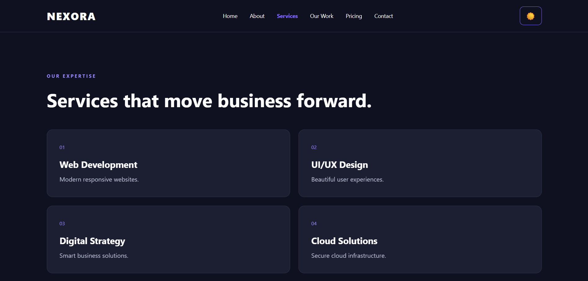
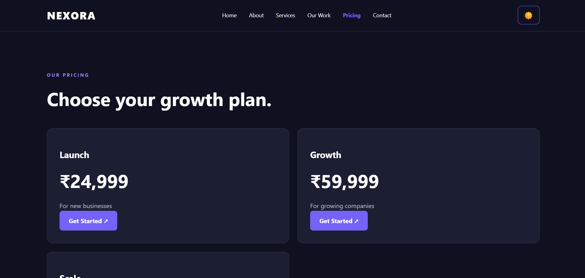
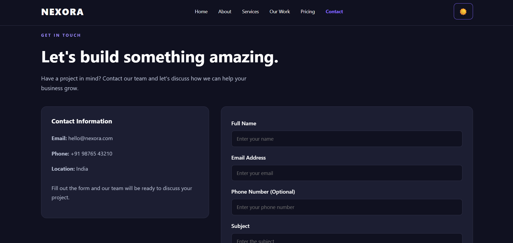

# NEXORA Technologies

A modern, responsive business website built using React, JavaScript, HTML5 and CSS3.

## About the Project

NEXORA Technologies is a business website showcasing digital services, company information, pricing plans and completed projects.

## Features

- Six responsive pages: Home, About, Services, Portfolio, Pricing and Contact
- Dark and light theme toggle
- Responsive navigation and mobile menu
- Interactive portfolio filters and project details
- Testimonials slider
- FAQ accordion
- Contact form with frontend validation
- Scroll progress indicator and back-to-top button
- CSS animations and hover effects
- SEO metadata and accessibility improvements

## Technologies Used

- React
- JavaScript ES6+
- HTML5
- CSS3
- React Router DOM
- Vite

## Installation

Install dependencies:

```bash
npm install
```

Start development server:

```bash
npm run dev
```

Create production build:

```bash
npm run build
```

Preview production build:

```bash
npm run preview
```

## Project Structure

- `public/` - Static assets and images
- `src/components/` - Reusable React components
- `src/pages/` - Website pages
- `lighthouse/` - Performance audit reports
- `README.md` - Project documentation

## Performance Testing

Lighthouse audit reports are available in the `lighthouse/` folder.

## Project Name

NEXORA Technologies
## Website Screenshots

### Home Page


### About Page


### Services Page


### Our Work Page


### Pricing Page


### Contact Page
