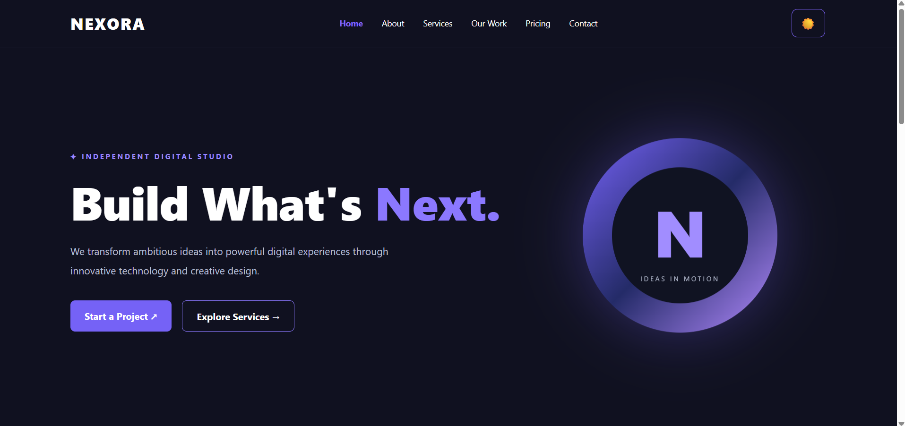
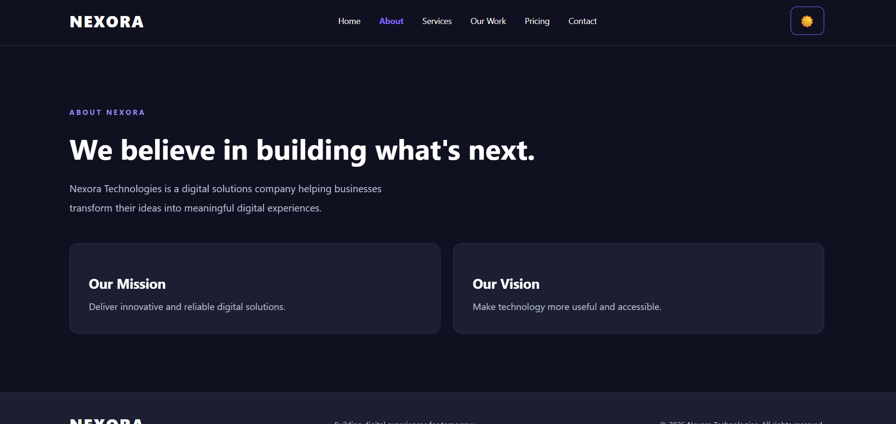

# NEXORA Technologies

A modern, responsive business website built using React, JavaScript, HTML5 and CSS3.


## Live Website

Frontend: https://nexora-technologies-beta-rust.vercel.app

Backend API: https://nexora-technologies-qdnz.onrender.com

GitHub Repository: https://github.com/subhojitg204/nexora-technologies


## About the Project

NEXORA Technologies is a business website showcasing digital services, company information, pricing plans and completed projects.

## Features

- Six responsive pages: Home, About, Services, Portfolio, Pricing and Contact
- Dark and light theme toggle
- Responsive navigation and mobile menu
- Interactive portfolio filters and project details
- Testimonials slider
- FAQ accordion
- Contact form with frontend validation
- Scroll progress indicator and back-to-top button
- CSS animations and hover effects
- SEO metadata and accessibility improvements

### User Authentication & Dashboard

- User registration and login
- Secure password hashing using bcrypt
- JWT-based authentication with HTTP-only cookies
- Protected user dashboard
- User profile editing
- Change password functionality
- Automatic session invalidation after password change
- Secure logout and protected routes
- PostgreSQL database integration


## Technologies Used

- React
- JavaScript ES6+
- HTML5
- CSS3
- React Router DOM
- Vite

### Backend Technologies

- Node.js
- Express.js
- PostgreSQL (Neon Database)
- JWT (JSON Web Tokens)
- bcrypt for password hashing
- HTTP-only cookies for authentication
- CORS for frontend-backend communication

### Deployment

- Frontend: Vercel
- Backend: Render
- Database: Neon PostgreSQL
- Version Control: Git and GitHub


## Installation

Install dependencies:

```bash
npm install
```

Start development server:

```bash
npm run dev
```

Create production build:

```bash
npm run build
```

Preview production build:

```bash
npm run preview
```

## Project Structure

- `public/` - Static assets and images
- `src/components/` - Reusable React components
- `src/pages/` - Website pages
- `lighthouse/` - Performance audit reports
- `README.md` - Project documentation


### Backend Setup

The backend is built using Node.js, Express.js, and PostgreSQL.

#### 1. Navigate to the server folder

```bash
cd server
```

#### 2. Install backend dependencies

```bash
npm install
```

#### 3. Configure environment variables

Create a `.env` file inside the `server/` folder.

Configure the database connection, JWT secret, frontend URL, and other environment variables required by the backend.

Never commit `.env` files or secret keys to GitHub.

#### 4. Start the backend server

```bash
node server.js
```

#### 5. Start the frontend

Open another terminal in the main project folder:

```bash
npm run dev
```

The frontend runs at:

http://localhost:5173

The backend runs at:

http://localhost:5000


## Performance Testing

Lighthouse audit reports are available in the `lighthouse/` folder.

## Project Name

NEXORA Technologies
## Website Screenshots

### Home Page


### About Page


### Services Page


### Our Work Page


### Pricing Page


### Contact Page
